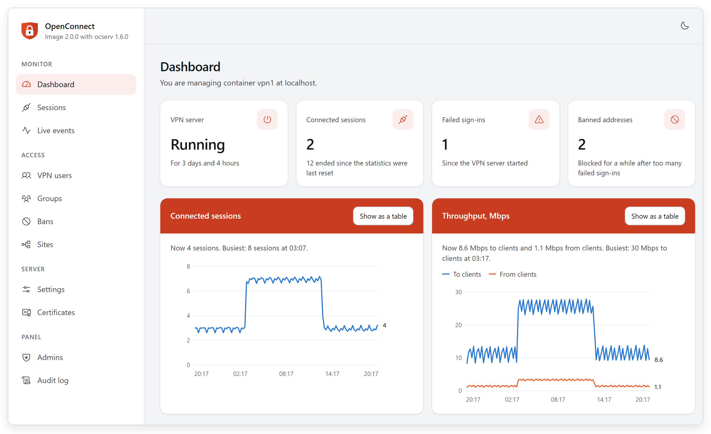

<div align="center">


# OpenConnect VPN Server

**ocserv in Docker, built from the newest signed release, with a hardened default configuration.**

[](https://hub.docker.com/r/markusmcnugen/openconnect)
[](https://github.com/MarkusMcNugen/docker-openconnect/actions/workflows/publish.yml)
[](https://github.com/MarkusMcNugen/docker-openconnect/blob/main/LICENSE)

**[Documentation](https://markusmcnugen.github.io/docker-openconnect/)** | [Getting started](https://markusmcnugen.github.io/docker-openconnect/docs/tutorials/getting-started/) | [Environment variables](https://markusmcnugen.github.io/docker-openconnect/docs/reference/environment-variables/) | [Docker Hub](https://hub.docker.com/r/markusmcnugen/openconnect) | [Changelog](https://github.com/MarkusMcNugen/docker-openconnect/blob/main/CHANGELOG.md)

<picture>
  <source media="(prefers-color-scheme: dark)" srcset="https://raw.githubusercontent.com/MarkusMcNugen/docker-openconnect/main/wiki/static/images/readme/dashboard-dark.png">
  
</picture>

[ocserv](https://ocserv.openconnect-vpn.net/) is the OpenConnect VPN server: an SSL VPN that OpenConnect clients and Cisco Secure Client (AnyConnect) connect to over TLS, with a UDP channel for speed. This image compiles the newest ocserv release after checking its signature, runs it without `--privileged`, and closes the paths a VPN can leak through, IPv6 and DNS included. Every setting is an environment variable.

</div>

---

<details>
<summary><b>Table of contents</b></summary>

- [Features](#features)
- [Quick start](#quick-start)
- [Why this image](#why-this-image)
- [Configuration](#configuration)
- [Security](#security)
- [Upgrading from 1.x](#upgrading-from-1x)
- [Repository layout](#repository-layout)
- [Building and testing](#building-and-testing)
- [Platforms](#platforms)
- [Wiki](#wiki)
- [Credits](#credits)
- [Use of AI tools](#use-of-ai-tools)
- [License](#license)
- [Contributing](#contributing)

</details>

---

## Features

<details open>
<summary><b>What you get</b></summary>

- The newest ocserv release, compiled from its signed tarball; a new upstream release is [published within a day](https://markusmcnugen.github.io/docker-openconnect/docs/explanation/how-the-image-stays-current/).
- [No leaks](https://markusmcnugen.github.io/docker-openconnect/docs/explanation/security-model/#leak-protection): full-tunnel clients get an IPv6 address and route through the VPN, so native IPv6 cannot bypass it, and DNS goes through the tunnel.
- TLS 1.3 and 1.2 with forward secrecy and AEAD ciphers only.
- A default-drop firewall inside the container, with VPN clients isolated from each other and route restriction in split-tunnel mode.
- No `--privileged`: a read-only container with only the capabilities it uses, and no package manager or OpenSSL inside.
- [Every ocserv option as an environment variable](https://markusmcnugen.github.io/docker-openconnect/docs/reference/environment-variables/), with moderate defaults for each limit.
- [Two-factor login](https://markusmcnugen.github.io/docker-openconnect/docs/how-to/add-two-factor-login/) with time-based one-time codes.
- [Certificate sign-in](https://markusmcnugen.github.io/docker-openconnect/docs/how-to/sign-in-with-certificates/), alone or with the password, from a client CA that signs nothing else.
- [Camouflage](https://markusmcnugen.github.io/docker-openconnect/docs/how-to/hide-the-server-with-camouflage/): the server looks like an empty web site without a secret in the URL.
- A private CA and server certificate created on first start and renewed with the same key, or [your own certificate](https://markusmcnugen.github.io/docker-openconnect/docs/how-to/use-your-own-certificate/), reloaded when it changes.
- [PROXY protocol](https://markusmcnugen.github.io/docker-openconnect/docs/how-to/run-behind-a-reverse-proxy/) for running behind Traefik or HAProxy on a shared port 443.
- [Several servers behind one load balancer](https://markusmcnugen.github.io/docker-openconnect/docs/how-to/run-several-servers-behind-a-load-balancer/), each draining its sessions when it stops.
- Images for `linux/amd64`, `linux/arm64` and `linux/arm/v7`, each with an SBOM and build provenance.
- [Upgrades in place](https://markusmcnugen.github.io/docker-openconnect/docs/how-to/upgrade-from-1x/) from the 1.x image, keeping users, certificates and hand-edited settings.
- An optional [web admin panel](https://markusmcnugen.github.io/docker-openconnect/docs/reference/environment-variables/#admin-panel), off by default: sessions, VPN users with a printable onboarding kit, groups, bans, live events and an audit log, behind passkeys or authenticator codes.
- A firewall blocklist that drops an address on every port, by hand or after repeated bans.
- [Country rules](https://markusmcnugen.github.io/docker-openconnect/docs/how-to/block-countries/) that block listed countries, or allow only them, at the firewall, with DB-IP Lite in the image or MaxMind GeoLite2 with your own key.
- [Location checks](https://markusmcnugen.github.io/docker-openconnect/docs/how-to/check-where-sign-ins-come-from/) that score each VPN and panel sign-in by where it comes from against the account's habits, alert on an unusual one and refuse an implausible one, with vacations and Allow this place.
- [Alerts](https://markusmcnugen.github.io/docker-openconnect/docs/how-to/get-alerts/) to each admin's phone, chat or inbox through ntfy, Telegram, a webhook or email: automatic blocks, panel sign-ins from outside your networks, location check refusals, and a daily count of country rule drops.
- An optional user portal where VPN users see how to connect, change their password and set up their authenticator app.

</details>

## Quick start

```yaml
services:
  openconnect:
    image: markusmcnugen/openconnect:latest
    container_name: openconnect
    restart: unless-stopped
    ports:
      - "4443:4443/tcp"
      - "4443:4443/udp"
    environment:
      SRV_CN: vpn.example.com
    volumes:
      - ./config:/config
    devices:
      - /dev/net/tun:/dev/net/tun
    cap_drop: [ALL]
    cap_add: [CHOWN, DAC_OVERRIDE, FOWNER, KILL, NET_ADMIN, NET_BIND_SERVICE, NET_RAW, SETGID, SETUID]
    security_opt: ["no-new-privileges:true"]
    read_only: true
    tmpfs: [/run, /tmp]
    sysctls:
      net.ipv4.ip_forward: 1
      net.ipv6.conf.all.forwarding: 1
      net.ipv6.conf.all.disable_ipv6: 0
      net.ipv6.conf.default.disable_ipv6: 0
```

Start it, add a user, and read the server's key pin from the log:

```bash
docker compose up -d
docker exec -it openconnect ocpasswd -c /config/ocpasswd alice
docker logs openconnect
```

Forward TCP and UDP port 4443 to the host, then connect with the pin the log prints:

```bash
sudo openconnect --user=alice --servercert=pin-sha256:... https://vpn.example.com:4443/
```

[Getting Started](https://markusmcnugen.github.io/docker-openconnect/docs/tutorials/getting-started/) walks through the same steps with the `docker run` form, Cisco Secure Client, and a check that the tunnel carries IPv4 and IPv6.

## Why this image

The image runs the newest ocserv with its safety settings on by default: forward-secret TLS, compression off, a firewall that forwards only client traffic and its replies, isolated clients, sandboxed worker processes, and an IPv6 route for every full-tunnel client, so the VPN carries everything a client sends. Each of those is one variable to change.

The configuration is rebuilt from the environment at every start, so it matches the container's settings and never accumulates edits. An option with no named variable is set with `OCSERV_CONF_<OPTION>`, and a fragment file or power-user mode covers the rest.

## Configuration

The settings people change most:

| Variable | Default | Meaning |
|---|---|---|
| `SRV_CN` | `vpn.example.com` | Host name clients connect to, used in the created certificate |
| `LISTEN_PORT` | `4443` | Port for TCP and UDP |
| `TUNNEL_MODE` | `all` | `all`, or `split-include` with `TUNNEL_ROUTES` |
| `DNS_SERVERS` | `9.9.9.9,1.1.1.1` | DNS servers pushed to clients |
| `MAX_SAME_CLIENTS` | `4` | Sessions per user |
| `CAMOUFLAGE_SECRET` | unset | Hides the server without this string in the URL |
| `OCSERV_CONF_<OPTION>` | | Any other ocserv option |

<details>
<summary><b>Every variable</b></summary>

Listening: `LISTEN_PORT`, `UDP_PORT`, `DTLS`, `LISTEN_HOST`, `PROXY_PROTOCOL`.
Tunnel: `TUNNEL_MODE`, `TUNNEL_ROUTES`, `NO_ROUTES`, `VPN_NETWORK`, `IPV6`, `VPN_IPV6_NETWORK`, `DNS_SERVERS`, `SPLIT_DNS_DOMAINS`, `DEFAULT_DOMAIN`, `TUNNEL_ALL_DNS`.
Firewall: `FIREWALL_BACKEND`, `NAT`, `CLIENT_TO_CLIENT`, `RESTRICT_TO_ROUTES`.
Security: `CISCO_COMPAT`, `TLS_PRIORITIES`, `CAMOUFLAGE_SECRET`, `CAMOUFLAGE_REALM`, `SECURITY_HEADERS`, `BANNER`, `PRE_LOGIN_BANNER`.
Limits and timers: `MAX_CLIENTS`, `MAX_SAME_CLIENTS`, `IDLE_TIMEOUT`, `MOBILE_IDLE_TIMEOUT`, `SESSION_TIMEOUT`, `RX_DATA_PER_SEC`, `TX_DATA_PER_SEC`, `AUTH_TIMEOUT`, `COOKIE_TIMEOUT`, `MAX_BAN_SCORE`, `BAN_TIME`, `BAN_RESET_TIME`, `BAN_POINTS_WRONG_PASSWORD`, `RATE_LIMIT_MS`, `KEEPALIVE`, `DPD`, `MOBILE_DPD`, `SWITCH_TO_TCP_TIMEOUT`, `MTU`, `SERVER_DRAIN_MS`, `LOG_LEVEL`.
Users: `PASSWD_FILE`, `OTP_FILE`, `AUTH_MODE`.
Certificates: `SERVER_CERT`, `SERVER_KEY`, `CERT_KEY_TYPE`, `SRV_CN`, `SRV_SAN`, `SRV_ORG`, `SRV_DAYS`, `CA_CN`, `CA_ORG`, `CA_DAYS`.
Files: `POWER_USER`, `EXTRA_CONFIG`, `PUID`, `PGID`, `CONFIG_DIR`, `RUNTIME_DIR`.

Each is described, with its default and the ocserv option it sets, in the [environment variables reference](https://markusmcnugen.github.io/docker-openconnect/docs/reference/environment-variables/).

</details>

## Security

- ocserv's tarball is verified against its maintainer's signing key, pinned by fingerprint, before it is compiled with stack protection, fortified functions and full RELRO.
- Workers that handle client traffic run as an unprivileged user under a seccomp filter with a memory ceiling.
- Banning, session limits, optional one-time codes and camouflage protect logins.
- Alpine is pinned by digest and every workflow action by commit.

The [security model](https://markusmcnugen.github.io/docker-openconnect/docs/explanation/security-model/) covers each protection and where it is set.

## Upgrading from 1.x

Pull the new image and recreate the container on the same `/config`. Untouched 1.x files are renamed `*.legacy` and the environment takes over; a hand-edited `ocserv.conf` keeps working as the whole configuration. `--privileged` can be replaced by the flags above. [Upgrade From 1.x](https://markusmcnugen.github.io/docker-openconnect/docs/how-to/upgrade-from-1x/) lists every change.

## Repository layout

| Path | Role |
|---|---|
| `Dockerfile` | Three stages: resolve, verify and compile ocserv; cross-compile the admin panel; then the runtime image |
| `scripts/latest-ocserv-version.sh` | The newest stable ocserv version on the upstream server |
| `scripts/check-crate-age.py` | CI check that every locked crate release is at least 14 days old |
| `panel/` | The admin panel, in Rust |
| `keys/ocserv-signing-key.asc` | The ocserv maintainer's public key |
| `patches/` | Patches the build applies to the ocserv source |
| `rootfs/usr/local/bin/docker-entrypoint.sh` | Start sequence |
| `rootfs/usr/local/lib/ocserv-docker/` | Settings, configuration, certificates, firewall, system checks, 1.x upgrade |
| `rootfs/usr/local/libexec/ocserv-docker/session-hook` | Connect and disconnect logging and user hooks |
| `tests/run.sh` | Unit, smoke and emulated tests |
| `tests/fixtures/legacy-1.x/` | Files the 1.x image shipped |
| `docker-compose.yml` | The hardened run settings |
| `.github/workflows/` | Publishing and the wiki |
| `wiki/` | The documentation site |
| `CHANGELOG.md` | What changed in each version; each version ships as one commit on top of the one before |

## Building and testing

```bash
docker build -t openconnect .
bash tests/run.sh unit
bash tests/run.sh smoke openconnect
```

`unit` checks the entrypoint modules in any bash 5 shell. `smoke` starts the image with the settings above, under Docker or podman, connects OpenConnect clients built with OpenSSL and with GnuTLS, and checks the tunnel, the UDP channel, IPv6 leak protection, DNS, client isolation, split tunneling with route restriction, camouflage, two-factor login, restarts and 1.x upgrades. [Tests](https://markusmcnugen.github.io/docker-openconnect/docs/reference/tests/) lists every check. `--build-arg OCSERV_VERSION=1.6.0` builds a specific release.

## Platforms

- Images: `linux/amd64`, `linux/arm64`, `linux/arm/v7`. The publish workflow runs the smoke test on amd64 and arm64 machines and the emulated checks for arm/v7 before tagging.
- Verified on an Ubuntu 24.04 x86-64 virtual machine with rootless podman 4.9.3.
- Hosts: Linux with Docker or podman, the tun device and nf_tables; legacy iptables is used where nf_tables is missing.

## Wiki

The documentation site is at **[markusmcnugen.github.io/docker-openconnect](https://markusmcnugen.github.io/docker-openconnect/)**, built from [`wiki/`](https://github.com/MarkusMcNugen/docker-openconnect/tree/main/wiki) on every push to main. It is organized by the Diataxis framework: a getting-started tutorial; how-to guides for users, certificates, split tunnels, camouflage, two-factor login, reverse proxies, unRAID, customizing ocserv, upgrading and troubleshooting; explanations of the security model, the configuration and how the image stays current; and reference pages for every variable, file, command, log line and test.

## Credits

- [ocserv](https://gitlab.com/openconnect/ocserv), by Nikos Mavrogiannopoulos and its contributors, is the server this image runs.
- [OpenConnect](https://www.infradead.org/openconnect/) is the client the tests connect with.
- The admin panel generates VPN passwords from the [EFF large word list](https://www.eff.org/dice), by the Electronic Frontier Foundation, under CC BY 3.0.
- The admin panel's icons are [Phosphor Icons](https://phosphoricons.com/), under the MIT license, whose notice the image carries in `/usr/share/licenses/phosphor-icons/LICENSE`.
- The admin panel's country flags are [flag-icons](https://flagicons.lipis.dev/), by Panayiotis Lipiridis, under the MIT license, whose notice the image carries in `/usr/share/licenses/flag-icons/LICENSE`.
- The admin panel's typefaces are [Geist and Geist Mono](https://github.com/vercel/geist-font), by the Geist Project Authors, under the SIL Open Font License 1.1, which the image carries in `/usr/share/licenses/geist/OFL.txt`.
- [IP Geolocation by DB-IP](https://db-ip.com): the image carries DB-IP's IP to Country Lite database for the country rules, licensed [CC BY 4.0](https://creativecommons.org/licenses/by/4.0/), whose notice the image carries in `/usr/share/licenses/dbip-country-lite/LICENSE`.
- This image began as a fork of TommyLau's ocserv image.

## Use of AI tools

The author used Claude (Anthropic) via the Claude Code CLI for code development, documentation drafting and test scripting. All design decisions were made by the author. The image, its entrypoint and its tests were verified by building the image and running the unit and smoke suites against it.

## License

GPL-3.0, see [LICENSE](https://github.com/MarkusMcNugen/docker-openconnect/blob/main/LICENSE). ocserv itself is GPL-2.0-or-later.

## Contributing

Issues and pull requests are welcome at [github.com/MarkusMcNugen/docker-openconnect](https://github.com/MarkusMcNugen/docker-openconnect). Run `bash tests/run.sh unit` and the smoke test before sending a change to the entrypoint.
